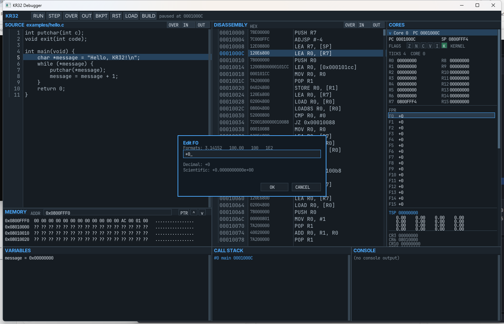
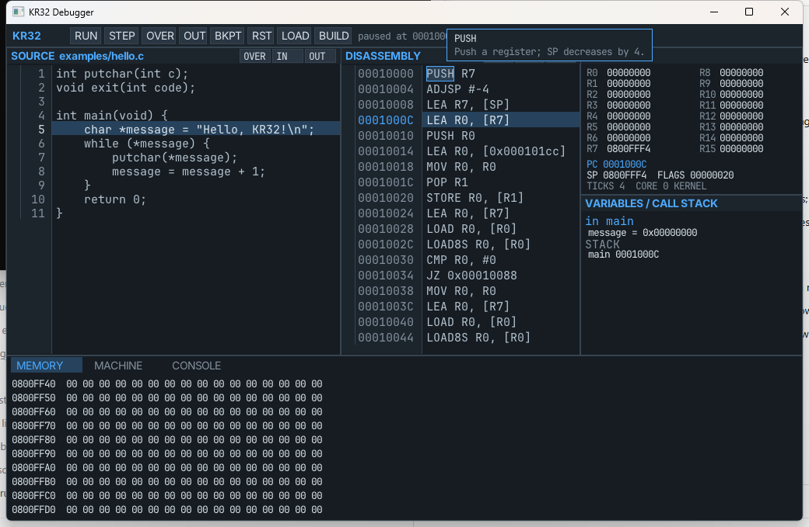

# Windowed debugger (M6)

`kr32 gui <image.k32|source.c>` opens the portable debugger at 1440x900. A C
source is compiled, assembled, linked, and loaded in memory; `.k32`
executables load directly.








## Architecture

- `ui::Canvas` is a 32-bit RGBA software canvas (`0xAARRGGBB`) with rectangles,
  frames, lines, PPM output, a deterministic frame hash, and TTF glyph
  rasterization. It has no OS or SDL dependency. Fonts are embedded with
  `stb_truetype`: Inter Regular/Bold 14 px for UI text and JetBrains Mono
  Regular 15/13 px for source, disassembly, registers, and small labels. The
  source pane switches to the 13 px mono role when narrow and returns to 15 px
  when it has room.
  Both font families are SIL OFL 1.1; see `third_party/fonts/`.
- `ui::DebuggerUI` owns a `debug::Session`, source text, breakpoints, panel scroll
  state, and all painting/hit-testing. It is usable headlessly.
- `platform::Window` is the SDL2 boundary: one window, one streaming ARGB8888
  texture, keyboard/mouse event mapping, and the `SDL_VIDEODRIVER=dummy` smoke
  path. Resizing the window recreates the software surface and texture at the
  new size; the pane layout adapts instead of scaling the initial frame.

## Layout

| Area | Contents |
| --- | --- |
| Toolbar | Run, Step, Over, Out, Breakpoint, Reset, Load, Build, status, instruction/time/IPS counters, stats reset |
| Status bar | Current status on the left; active mode key hints on the lower right |
| Source | Gutter with line numbers and breakpoint squares, source text, current-line highlight, line-step Over/In/Out |
| Disassembly | Address/breakpoint gutter, HEX word column, mnemonics, current-PC highlight, instruction-step Over/In/Out |
| Cores | One row per core; expandable core state with GPRs, FPRs, TSP/T0, paging, and control registers |
| Memory | Four-line address/hex/ASCII dump docked under the source pane |
| Variables | Current function, locals, and globals, always visible |
| Breakpoints | Address, source filename, and line for every breakpoint; red enabled / yellow disabled |
| Call stack | Current frames, always visible |
| Console | Guest console output, always visible |

**Load** opens the platform file picker (the native common dialog on Windows;
`zenity`/`kdialog` when available on Linux) and loads a `.k32` image or compiles
a selected `.c` or `.cpp` source. **Build** reloads/recompiles the currently
loaded source.

The **SOURCE** panel follows the current PC across debug source files. Stepping
into libc functions such as `printf` or `malloc` switches the title and text to
`src/cc/libc.c`, and the **VARIABLES** panel shows the active libc locals.
Click the filename in the **SOURCE** title to open a list of every source file
in the debug symbols. Selecting a file pins it in the source pane, where its
gutter can set and clear breakpoints; a later step, run, or restart returns the
pane to the file containing the new PC.
For OS boots, `gui --os` loads `kernel.sym` and `bios.sym` beside the raw
images; those CRC-checked sidecars provide C and assembly source lines, so the
panel follows BIOS, boot entry, and kernel code as the PC moves.

The right-hand **CORES** panel lists one row per core and is expandable. The
expanded row shows that core's PC/SP/FLAGS, GPRs, F0-F15, TSP and T0 tile,
paging registers, and control registers. F0-F15 are shown in two columns of
eight. The FPR header has a **DOUBLE / FLOAT** toggle: DOUBLE interprets the full
64-bit register, while FLOAT interprets the low 32 bits used by `.S`
instructions. In DOUBLE view, a register whose upper 32 bits are zero is also
labelled with its float value (`f32`), since that is how `.W` loads and
`.S` results appear. Click an FPR to open the floating-point editor. Click a
T0 matrix cell to edit it as a floating-point value. Hovering a T0 cell, the TSP
pointer, a control register, or PTBR shows a tooltip with the value and its
meaning. Click a core row to select it or collapse/expand its details. The
**MEMORY** panel is docked beneath the source pane and shows four
address/hex/ASCII lines. **VARIABLES**, **BREAKPOINTS**, **CALL STACK**, and
**CONSOLE** remain visible along the bottom row.

When the pointer is over the **CONSOLE** panel, printable keys, Enter,
Backspace, and Ctrl-V are routed to the guest serial tty. Enter sends LF,
Backspace sends DEL (`0x7F`), and Ctrl-V pastes clipboard text normalized to LF.
Function keys remain debugger shortcuts. The serial RX queue is 4 KiB with an
overrun status bit.

The memory starting address is editable: click anywhere on the **ADDR** field or
label, type up to eight hex digits, then press Enter; Escape cancels. **PTR**
follows the current SP, and the **^** / **v** buttons move the dump up or down
one 16-byte row.

## Settings

The toolbar gear at the upper right opens the settings dialog. It provides:

- **Command line arguments** passed to `main(argc, argv)` and available through
  `sys_argc`/`sys_arg`.
  Arguments use Windows-style quoting; backslashes are literal unless they
  precede a double quote.
- **Run instruction limit**; zero means unlimited. The value applies to Run and
  Run-to and is saved in the settings file.
- **Stop at main after load**; disable it to pause at the image entry instead.
- **Write assembler listing (.lst)** beside the compiled C/C++ source.

**APPLY & RESTART** saves the settings, rebuilds the current source, and applies
the argument list. Settings are stored in `%APPDATA%\KR32\settings.ini` on
Windows, `XDG_CONFIG_HOME/kr32/settings.ini` when available, or
`kr32-settings.ini` in the current directory.

## Panel scrolling and editing

- Source, disassembly, cores, variables, call stack, and console panels have
  vertical scrollbars when their content exceeds the visible area.
- The console follows new output only while its view is already at the bottom.
  Scrolling upward detaches the view; returning to the bottom resumes following.
- Mouse-wheel scrolling works over every panel; clicking above or below a
  scrollbar thumb pages the corresponding panel. Source auto-follow suspends
  after manual scrolling and resumes on the next step/run.
- **Registers** are editable: click a GPR row, the PC cell, or the SP cell,
  type up to eight hex digits, and press Enter. Escape cancels. The active cell
  shows a highlighted edit cursor.
- **Floating-point registers** use a popup editor. Accepted forms include
  `3.14152`, `100.00`, `100`, and `1E2`; Enter commits and Escape cancels.
  The **DOUBLE / FLOAT** toggle selects whether the value is interpreted as a
  64-bit double or the low 32-bit float from `.S` operations. Float-like values
  (zero upper half) are also labelled `f32` in DOUBLE view.
  Hovering an FPR shows the signed decimal value, signed scientific value,
  the float interpretation when the upper half is zero, and the raw 64-bit hex
  encoding.
- The core flag row shows **Z N C V I K**. Click Z/N/C/V/I to toggle the bit;
  K is the current privilege mode and is read-only.
- Hovering a variable row shows a tooltip with its local/global kind, type,
  size, address, hex/decimal value, signed value, character interpretation,
  pointer target/string preview, and array/aggregate details.
- Hovering a GPR, PC, or SP cell shows its name, hex value, unsigned/signed
  decimal value, and character value when printable.
- Hovering a flag shows its full name, set/clear state, and meaning.
- Hovering a memory byte shows its address, hex byte, printable character,
  and unsigned/signed decimal value.

## Gutter behavior

- Source gutter: breakpoint square column, right-aligned line-number column, separators; source text starts after the gutter.
- Disassembly gutter: breakpoint square column, right-aligned address column with padding, separators; the instruction column starts after the gutter. It mirrors the source gutter geometry.
- Left-click a gutter row toggles a breakpoint at that line/instruction.
- Disabled breakpoints use a yellow square in the source and disassembly
  gutters; enabled breakpoints use red.
- The **BREAKPOINTS** panel lists every breakpoint by address, basename, and
  line. Its left gutter toggles enabled/disabled; clicking the row opens the
  source line. The right-hand scrollbar scrolls long lists.
- **RST** reloads the current image and preserves breakpoint addresses and
  enabled/disabled state.
- Right-click a source or disassembly gutter row opens the KR16-style menu:
  **Toggle breakpoint** and **Run to line N** / **Run to 0xADDR**.
- Run-to uses a temporary breakpoint, runs the CPU, and removes the temporary
  breakpoint when it stops. Existing user breakpoints are preserved.
- Run and Run-to honor the instruction limit configured in Settings. Execution
  is sliced so the window remains responsive; **RUN** turns green while active.
  If the limit is reached before the target or halt, the status line says so.
  A limit of zero runs without an instruction cap. Press Run again to pause.
- Hovering a gutter row highlights it.
- Hovering a disassembly mnemonic highlights it and shows an instruction
  description tooltip.
- Hovering an operand highlights it and shows an addressing-mode tooltip for
  each operand (register direct, `[Rn]`, `[Rn + displacement]`, immediate, and
  branch targets).
- The help text covers core integer, control, FP, and matrix instructions; the
  tooltip wraps to a 360 px line width and stays inside the window.
- The **HEX** column shows the raw instruction word as eight uppercase hex
  digits. When an instruction carries an extension word, both words are shown
  concatenated (sixteen digits), so the full encoding is always visible.

## Controls

- `F5` run to a breakpoint or halt. Run executes in slices and the **RUN**
  button turns green; press Run again to pause.
- `F6` breaks a running guest without starting a paused one.
- The bottom status bar shows the current status and the available keys for the
  active mode. While running it offers `F5 PAUSE` and `F6 BREAK`; the F5 badge
  is green in that mode.
- The toolbar counters show executed instructions, active run time, and
  instructions per second since the last reset or image load. **CLR** resets
  those counters.
- Hovering the console makes its **CONSOLE** title green, indicating keyboard
  input will go to the guest TTY. Typing while the guest is running does not
  pause it.
- `F10` instruction step over, `F11` instruction step in, `Shift+F11`
  instruction step out.
- The source-pane **OVER / IN / OUT** buttons step by C source line.
- The disassembly-pane **OVER / IN / OUT** buttons step by instruction.
- `F9` toggle a breakpoint at the current source line.
- `R` restart/reload; `Esc` quits.
- Click a core row to select it and toggle its expanded state.
- Click a GPR/PC/SP cell to edit it; click a Z/N/C/V/I flag to toggle it.
- Click an FPR to open the decimal/scientific editor; hover an FPR for its
  signed decimal, scientific, and hex values. Use the FPR **DOUBLE / FLOAT**
  toggle to switch the active interpretation.
- Hover a variable row for type/address/value details. The **VARIABLES** panel
  separates **Locals** and **Globals**; click a section header to collapse it.
  Floating-point values are shown as decimal text rather than raw bit patterns,
  and aggregate rows show `{...}` while their members expand below. Pointers to
  known structs and arrays expand into indented children. Array types include
  their bounds (`float[16]`, `char[32]`). Arrays start collapsed; click an
  array row to expand or collapse it. Large arrays show 16 elements per page
  with a `< page N/M >` row.
  Click the left arrow to step back; click the page text or right arrow to
  advance.
- Double-click a variable row to inspect its address, or a pointer's target, in
  the memory panel. Double-click a GPR, PC, or SP cell to send its value to the
  memory panel; a single click still opens the register editor.
- Click the memory **ADDR** field or label to edit the starting address; Enter
  commits and Escape cancels. **PTR** follows SP; **^** / **v** scroll by 16 bytes.
- Use the mouse wheel over a panel to scroll it; click a scrollbar track to page.
- Left-click a source or disassembly gutter row to toggle a breakpoint; right-click
  it for the gutter menu.

## Headless checks

```text
kr32 gui --headless build/hello-c.k32 --screenshot build/hello-ui.ppm
```

renders the complete 1440x900 debugger surface, writes a PPM screenshot, and
prints a stable frame hash. CTest's `ui_headless` uses this path, while
`ui_smoke` uses the SDL dummy driver. `KR32_BUILD_UI=OFF` excludes the SDL,
canvas, and GUI targets and keeps the headless test suite green.

## Current limits

- File dialogs are modal host services. Headless runs and KR32OS guests report
  the dialog as unavailable.
- "Break" is expressed through breakpoints; a cooperative pause of a running
  guest is not implemented.
