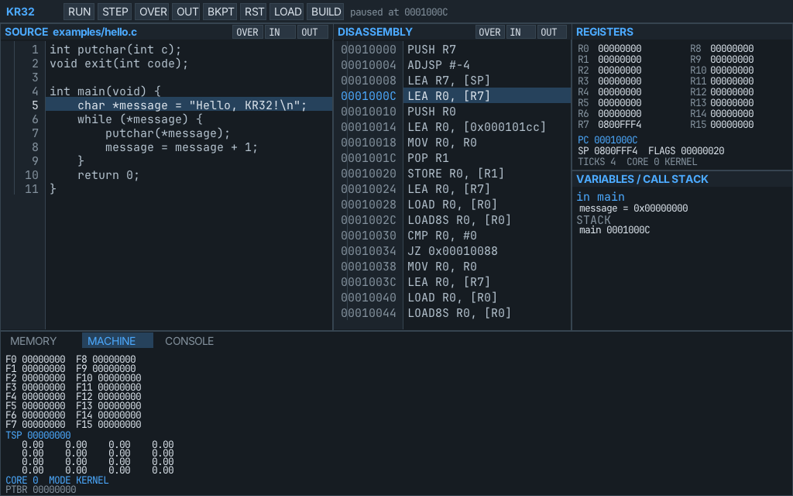
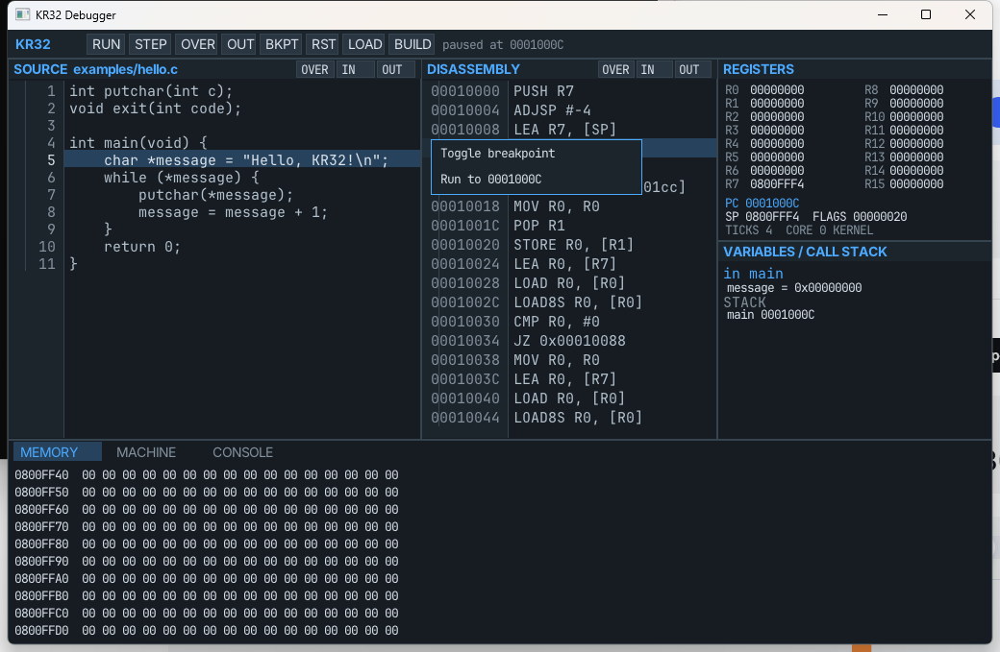
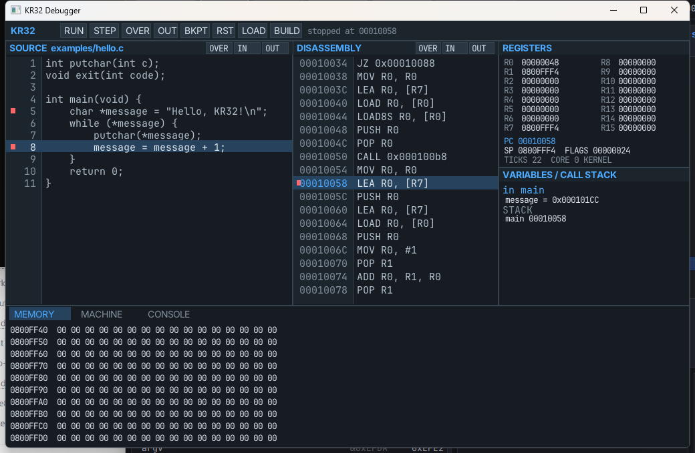

# Windowed debugger (M6)

`kr32 gui <image.k32|source.c>` opens the portable debugger. A C source is
compiled, assembled, linked, and loaded in memory; `.k32` executables load
directly.









## Architecture

- `ui::Canvas` is a 32-bit RGBA software canvas (`0xAARRGGBB`) with rectangles,
  frames, lines, PPM output, a deterministic frame hash, and TTF glyph
  rasterization. It has no OS or SDL dependency. Fonts are embedded with
  `stb_truetype`: Inter Regular/Bold 14 px for UI text and JetBrains Mono
  Regular 15/13 px for source, disassembly, registers, and small labels.
  Both font families are SIL OFL 1.1; see `third_party/fonts/`.
- `ui::DebuggerUI` owns a `debug::Session`, source text, breakpoints, tab state,
  and all painting/hit-testing. It is usable headlessly.
- `platform::Window` is the SDL2 boundary: one window, one streaming ARGB8888
  texture, keyboard/mouse event mapping, and the `SDL_VIDEODRIVER=dummy` smoke
  path. Resizing the window recreates the software surface and texture at the
  new size; the pane layout adapts instead of scaling the old 1024×640 frame.

## Layout

| Area | Contents |
| --- | --- |
| Toolbar | Run, Step, Over, Out, Breakpoint, Reset, Load, Build, status, counters |
| Source | Gutter with line numbers and breakpoint squares, source text, current-line highlight, line-step Over/In/Out |
| Disassembly | Address/breakpoint gutter, instruction bytes/mnemonics, current-PC highlight, instruction-step Over/In/Out |
| Registers | R0-R15, PC, SP, FLAGS, mode, ticks, core |
| Variables | Locals, globals/watch values, call stack |
| Bottom tabs | Memory hex dump, machine state, console |
| Machine tab | FPRs, T0 4x4 tile, PTBR/page table entries, control registers, TSP, core/mode |

## Gutter behavior

- Source gutter: breakpoint square column, right-aligned line-number column, separators; source text starts after the gutter.
- Disassembly gutter: breakpoint square column, right-aligned address column, separators; the instruction column starts after the gutter.
- Left-click a gutter row toggles a breakpoint at that line/instruction.
- Right-click a source or disassembly gutter row opens the KR16-style menu:
  **Toggle breakpoint** and **Run to line N** / **Run to 0xADDR**.
- Run-to uses a temporary breakpoint, runs the CPU, and removes the temporary
  breakpoint when it stops. Existing user breakpoints are preserved.
- Hovering a gutter row highlights it.

## Controls

- `F5` run to a breakpoint or halt.
- `F10` instruction step over, `F11` instruction step in, `Shift+F11`
  instruction step out.
- The source-pane **OVER / IN / OUT** buttons step by C source line.
- The disassembly-pane **OVER / IN / OUT** buttons step by instruction.
- `F9` toggle a breakpoint at the current source line.
- `R` restart/reload; `Tab` cycles the bottom tabs; `Esc` quits.
- Left-click a source or disassembly gutter row to toggle a breakpoint; right-click
  it for the gutter menu.

## Headless checks

```text
kr32 gui --headless build/hello-c.k32 --screenshot build/hello-ui.ppm
```

renders the memory, machine, and console tabs, writes PPM screenshots, and
prints stable per-tab hashes. CTest's `ui_headless` uses this path, while
`ui_smoke` uses the SDL dummy driver. `KR32_BUILD_UI=OFF` excludes the SDL,
canvas, and GUI targets and keeps the headless test suite green.

## Current limits

- There is no native file dialog, settings panel, or guest-argument editor yet;
  those are reserved for the M7 host services.
- "Break" is expressed through breakpoints; a cooperative pause of a running
  guest is not implemented.
