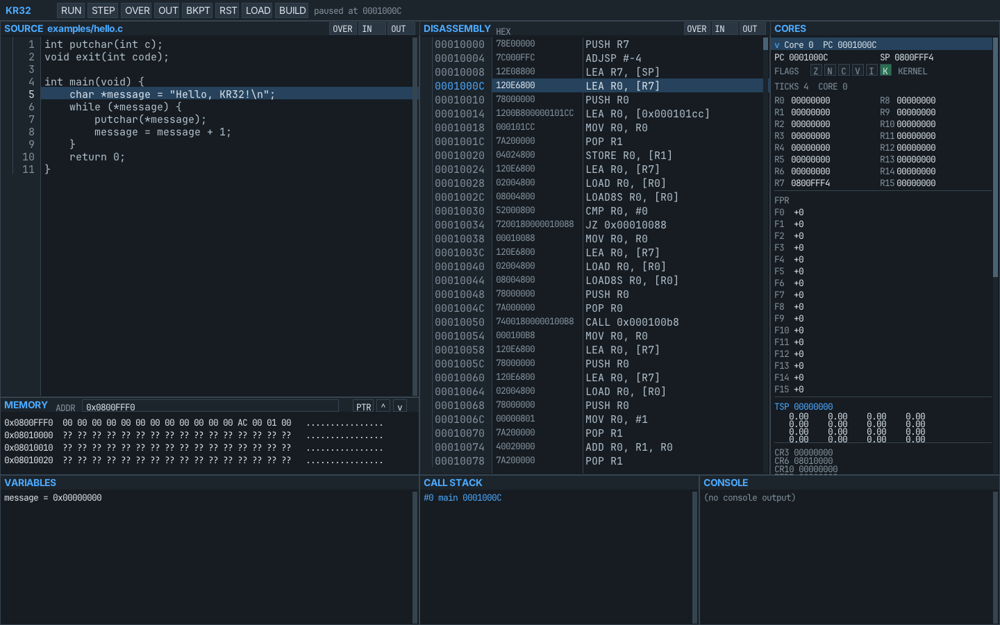
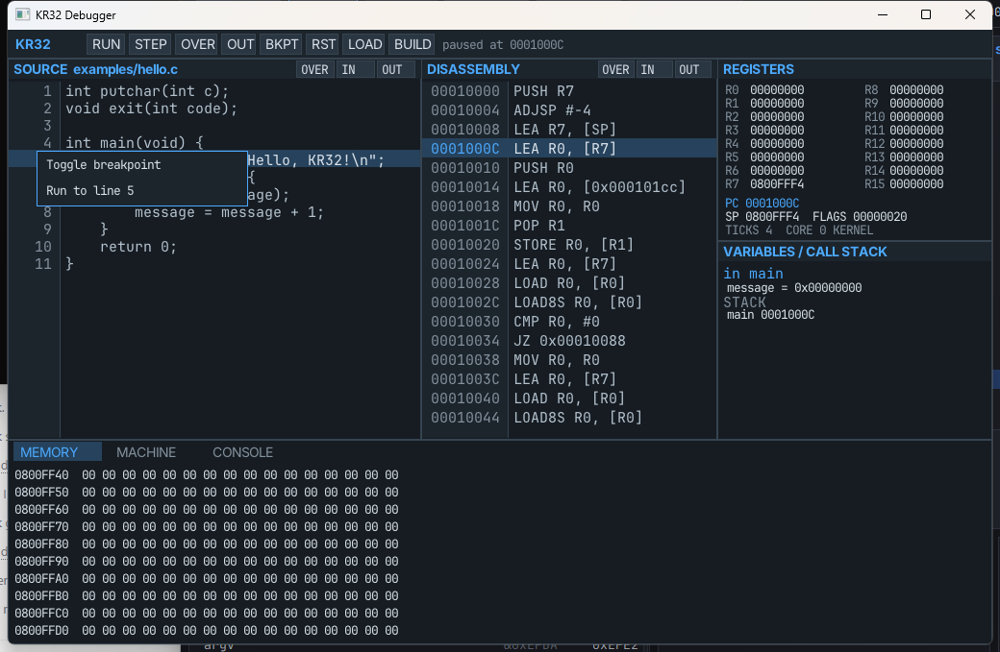
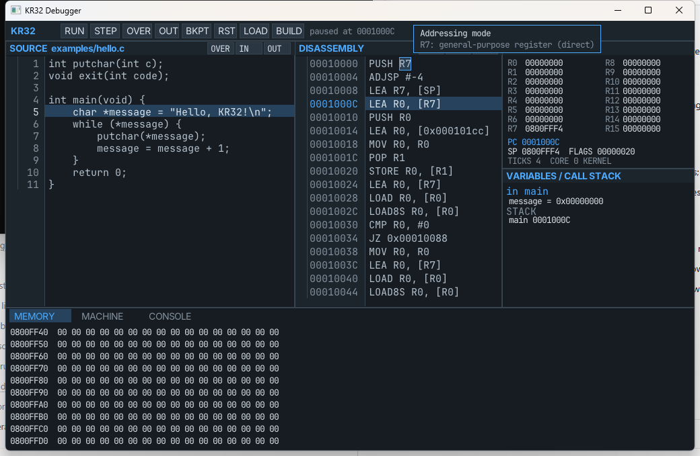

# Windowed debugger (M6)

`kr32 gui <image.k32|source.c>` opens the portable debugger at 1440x900. A C
source is compiled, assembled, linked, and loaded in memory; `.k32`
executables load directly.










## Architecture

- `ui::Canvas` is a 32-bit RGBA software canvas (`0xAARRGGBB`) with rectangles,
  frames, lines, PPM output, a deterministic frame hash, and TTF glyph
  rasterization. It has no OS or SDL dependency. Fonts are embedded with
  `stb_truetype`: Inter Regular/Bold 14 px for UI text and JetBrains Mono
  Regular 15/13 px for source, disassembly, registers, and small labels. The
  source pane switches to the 13 px mono role when narrow and returns to 15 px
  when it has room.
  Both font families are SIL OFL 1.1; see `third_party/fonts/`.
- `ui::DebuggerUI` owns a `debug::Session`, source text, breakpoints, panel scroll
  state, and all painting/hit-testing. It is usable headlessly.
- `platform::Window` is the SDL2 boundary: one window, one streaming ARGB8888
  texture, keyboard/mouse event mapping, and the `SDL_VIDEODRIVER=dummy` smoke
  path. Resizing the window recreates the software surface and texture at the
  new size; the pane layout adapts instead of scaling the initial frame.

## Layout

| Area | Contents |
| --- | --- |
| Toolbar | Run, Step, Over, Out, Breakpoint, Reset, Load, Build, status, counters |
| Source | Gutter with line numbers and breakpoint squares, source text, current-line highlight, line-step Over/In/Out |
| Disassembly | Address/breakpoint gutter, HEX word column, mnemonics, current-PC highlight, instruction-step Over/In/Out |
| Cores | One row per core; expandable core state with GPRs, FPRs, TSP/T0, paging, and control registers |
| Memory | Four-line address/hex/ASCII dump docked under the source pane |
| Variables | Current function, locals, and globals, always visible |
| Call stack | Current frames, always visible |
| Console | Guest console output, always visible |

The right-hand **CORES** panel lists one row per core and is expandable. The
expanded row shows that core's PC/SP/FLAGS, GPRs, F0-F15, TSP and T0 tile,
paging registers, and control registers. F0-F15 are shown one per line as full
64-bit doubles using decimal notation (falling back to scientific notation when
the decimal form does not fit). Click an FPR to open the floating-point editor.
Click a core row to select it or collapse/expand its details. The **MEMORY**
panel is docked beneath the source pane and shows four address/hex/ASCII lines.
**VARIABLES**, **CALL STACK**, and **CONSOLE** remain visible along the bottom
row, with the extra width freed by moving memory into the source column.

The memory starting address is editable: click anywhere on the **ADDR** field or
label, type up to eight hex digits, then press Enter; Escape cancels. **PTR**
follows the current SP, and the **^** / **v** buttons move the dump up or down
one 16-byte row.

## Panel scrolling and editing

- Source, disassembly, cores, variables, call stack, and console panels have
  vertical scrollbars when their content exceeds the visible area.
- Mouse-wheel scrolling works over every panel; clicking above or below a
  scrollbar thumb pages the corresponding panel. Source auto-follow suspends
  after manual scrolling and resumes on the next step/run.
- **Registers** are editable: click a GPR row, the PC cell, or the SP cell,
  type up to eight hex digits, and press Enter. Escape cancels. The active cell
  shows a highlighted edit cursor.
- **Floating-point registers** use a popup editor. Accepted forms include
  `3.14152`, `100.00`, `100`, and `1E2`; Enter commits and Escape cancels.
  Hovering an FPR shows the signed decimal value, signed scientific value, and
  the raw 64-bit hex encoding.
- The core flag row shows **Z N C V I K**. Click Z/N/C/V/I to toggle the bit;
  K is the current privilege mode and is read-only.
- Hovering a variable row shows a tooltip with its local/global kind, type,
  size, address, and value.

## Gutter behavior

- Source gutter: breakpoint square column, right-aligned line-number column, separators; source text starts after the gutter.
- Disassembly gutter: breakpoint square column, right-aligned address column with padding, separators; the instruction column starts after the gutter. It mirrors the source gutter geometry.
- Left-click a gutter row toggles a breakpoint at that line/instruction.
- Right-click a source or disassembly gutter row opens the KR16-style menu:
  **Toggle breakpoint** and **Run to line N** / **Run to 0xADDR**.
- Run-to uses a temporary breakpoint, runs the CPU, and removes the temporary
  breakpoint when it stops. Existing user breakpoints are preserved.
- Hovering a gutter row highlights it.
- Hovering a disassembly mnemonic highlights it and shows an instruction
  description tooltip.
- Hovering an operand highlights it and shows an addressing-mode tooltip for
  each operand (register direct, `[Rn]`, `[Rn + displacement]`, immediate, and
  branch targets).
- The help text covers core integer, control, FP, and matrix instructions; the
  tooltip wraps to a 360 px line width and stays inside the window.
- The **HEX** column shows the raw instruction word as eight uppercase hex
  digits. When an instruction carries an extension word, both words are shown
  concatenated (sixteen digits), so the full encoding is always visible.

## Controls

- `F5` run to a breakpoint or halt.
- `F10` instruction step over, `F11` instruction step in, `Shift+F11`
  instruction step out.
- The source-pane **OVER / IN / OUT** buttons step by C source line.
- The disassembly-pane **OVER / IN / OUT** buttons step by instruction.
- `F9` toggle a breakpoint at the current source line.
- `R` restart/reload; `Esc` quits.
- Click a core row to select it and toggle its expanded state.
- Click a GPR/PC/SP cell to edit it; click a Z/N/C/V/I flag to toggle it.
- Click an FPR to open the decimal/scientific editor; hover an FPR for its
  signed decimal, scientific, and hex values.
- Hover a variable row for type/address/value details.
- Click the memory **ADDR** field or label to edit the starting address; Enter
  commits and Escape cancels. **PTR** follows SP; **^** / **v** scroll by 16 bytes.
- Use the mouse wheel over a panel to scroll it; click a scrollbar track to page.
- Left-click a source or disassembly gutter row to toggle a breakpoint; right-click
  it for the gutter menu.

## Headless checks

```text
kr32 gui --headless build/hello-c.k32 --screenshot build/hello-ui.ppm
```

renders the complete 1440x900 debugger surface, writes a PPM screenshot, and
prints a stable frame hash. CTest's `ui_headless` uses this path, while
`ui_smoke` uses the SDL dummy driver. `KR32_BUILD_UI=OFF` excludes the SDL,
canvas, and GUI targets and keeps the headless test suite green.

## Current limits

- There is no native file dialog, settings panel, or guest-argument editor yet;
  those are reserved for the M7 host services.
- "Break" is expressed through breakpoints; a cooperative pause of a running
  guest is not implemented.
